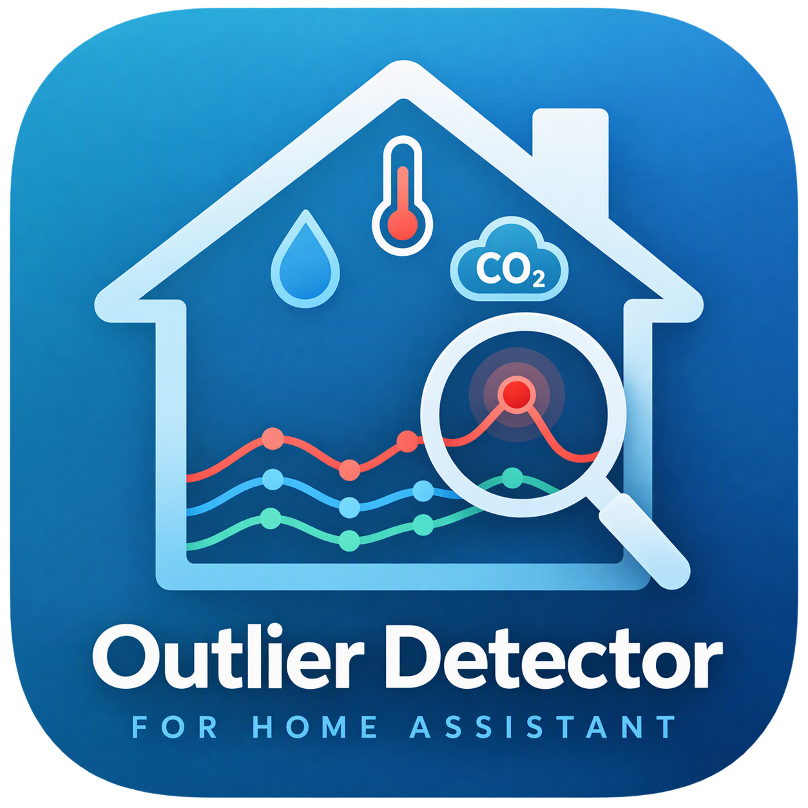

# Outlier Detector for Home Assistant

<p align="center">
  
</p>

A Home Assistant custom integration that detects anomalous sensors and environmental imbalances across multiple rooms.

The integration can compare groups of sensors such as:

- Temperature
- Humidity
- CO₂
- Pressure
- Air quality
- Any numeric sensor sharing the same unit of measurement

and create a binary sensor that indicates whether a significant deviation or imbalance has been detected.

---

## Features

### Outlier Detection

Detect sensors whose values differ significantly from the rest of the group.

Supported detection methods:

- Median Absolute Deviation (MAD)
- Standard Deviation (Sigma)
- Percentage Deviation
- Absolute Deviation

Example:

```text
20.1
20.0
19.9
27.5
```

The sensor reporting **27.5** would be detected as an outlier.

---

### Environmental Imbalance Detection

Detect situations where there are no statistical outliers but rooms are significantly different from each other.

Example:

```text
CO₂ Living Room:   720 ppm
CO₂ Bedroom:       730 ppm
CO₂ Office:        930 ppm
CO₂ Guest Room:    910 ppm
```

No individual sensor is faulty, but there is a clear imbalance between rooms.

This can be used to:

- Trigger internal air circulation
- Control motorized dampers
- Start balancing fans
- Improve HVAC efficiency
- Optimize residential ventilation systems

---

### Hysteresis Support

Optional hysteresis prevents rapid ON/OFF switching around threshold values.

Example:

```text
Threshold: 15 %
Hysteresis: 3 %
```

The detector will:

```text
Activate at 15 %
Deactivate at 12 %
```

This behavior is available for all detection methods.

---

### Unit Validation

The integration automatically validates that all monitored entities use the same unit.

Valid configuration:

```text
ppm
ppm
ppm
ppm
```

Invalid configuration:

```text
°C
ppm
%
```

Mixed units are rejected during configuration.

---

### Home Assistant UI Support

Configuration is fully supported through the Home Assistant user interface:

```text
Settings
→ Devices & Services
→ Add Integration
→ Outlier Detector
```

No YAML configuration is required.

---

## Detection Methods

### MAD (Median Absolute Deviation)

Recommended for most environmental sensors.

Pros:

- Robust against faulty sensors
- Works well with small groups
- Resistant to extreme values
- Ideal for temperature, humidity and CO₂ monitoring

Typical threshold:

```text
3.5
```

---

### Sigma (Standard Deviation)

Uses classical standard deviation analysis.

Typical threshold:

```text
2.0 - 3.0
```

Best suited for larger sensor groups.

---

### Percentage Deviation

Measures the relative deviation from the group average.

Formula:

```text
abs(value - average)
--------------------- × 100
      average
```

Typical threshold:

```text
10 % - 30 %
```

---

### Absolute Deviation

Measures deviation using the native unit.

Examples:

```text
3 °C
100 ppm
10 %
```

Useful when an engineering limit is already known.

---

### Imbalance Percent

Measures the difference between the highest and lowest values relative to the group average.

Formula:

```text
(max - min)
----------- × 100
  average
```

Example:

```text
720
730
910
930
```

Result:

```text
29.1 %
```

This method is especially useful for:

- CO₂ balancing between rooms
- HVAC optimization
- Air circulation control
- Multi-room environmental monitoring

Typical threshold:

```text
10 % - 20 %
```

---

## Entities Created

### Binary Sensor

Example:

```text
binary_sensor.office_co2_anomaly
```

Indicates whether the configured detection condition is active.

State:

```text
ON  -> Condition detected
OFF -> Normal operation
```

---

### Statistics Sensor

Example:

```text
sensor.office_co2_statistics
```

Provides diagnostic information including:

- Mean
- Median
- Standard deviation
- MAD
- Imbalance
- Imbalance percentage
- Outlier count
- Outlier entities
- Maximum score
- Detection thresholds
- Hysteresis settings

---

## Example Use Cases

### Detect a Faulty Temperature Sensor

Sensors:

```text
20.1
20.0
19.8
31.2
```

Recommended configuration:

```text
Method: MAD
Threshold: 3.5
```

---

### Balance CO₂ Between Rooms

Sensors:

```text
Bedroom:     950 ppm
Office:      930 ppm
Living Room: 700 ppm
Kitchen:     680 ppm
```

Recommended configuration:

```text
Method: IMBALANCE_PERCENT
Threshold: 15
Hysteresis: 3
```

Use the detector to activate air recirculation or balancing fans.

---

### Detect Abnormal Humidity Measurements

Sensors:

```text
45 %
46 %
44 %
62 %
```

Recommended configuration:

```text
Method: Percentage
Threshold: 20
```

---

## Installation

### HACS

1. Open HACS.
2. Add this repository as a Custom Repository.
3. Select **Integration** as category.
4. Install **Outlier Detector**.
5. Restart Home Assistant.
6. Add the integration from **Devices & Services**.

---

### Manual Installation

Copy the integration folder:

```text
custom_components/outlier_detector
```

into:

```text
config/custom_components/
```

Restart Home Assistant and add the integration from the UI.

---

## Requirements

- Home Assistant 2025.1.0 or newer

---

## Roadmap

Future improvements under consideration:

- Additional clustering-based detection algorithms
- Per-method default thresholds
- Diagnostic sensors for Mean, Median and MAD
- Device diagnostics support
- Advanced HVAC balancing strategies
- Adaptive thresholds

---

## License

MIT License
